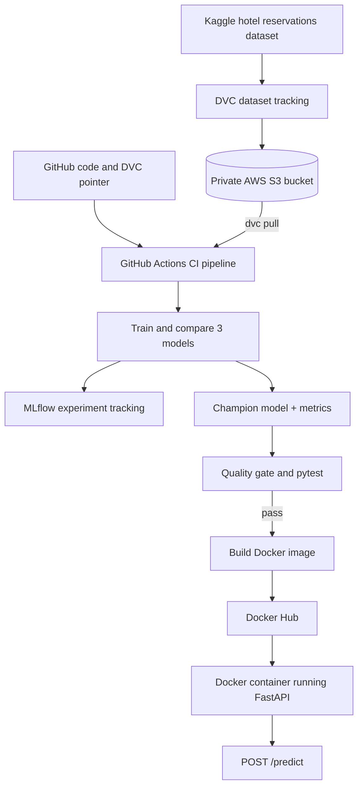

# Hotel Booking Cancellation Prediction | End-to-End MLOps

A reproducible, end-to-end **machine learning operations (MLOps)** project that predicts whether a hotel reservation will be **Canceled** or **Not_Canceled**. It combines model training, experiment tracking, dataset versioning, automated testing, CI/CD, an inference API, and container publishing.

> **Project status:** Core MLOps workflow implemented and verified locally, including model training, MLflow, DVC + AWS S3, GitHub Actions, FastAPI, automated tests, and Docker Hub publishing. Monitoring and orchestration improvements are listed under Future Enhancements.

## Overview

| Item | Details |
|---|---|
| Problem | Supervised binary classification |
| Dataset | [Hotel Reservations Classification Dataset (Kaggle)](https://www.kaggle.com/datasets/ahsan81/hotel-reservations-classification-dataset) |
| Records | 36,275 historical reservations |
| Original columns | 19, including booking ID and target |
| Model inputs | 17 booking-related features |
| Target | `booking_status` (`Canceled` / `Not_Canceled`) |
| Champion | **Random Forest** |
| Primary selection metric | F1 score, with ROC-AUC as tie-breaker |

## Model results

Results from the completed local training run (November 8, 2026):

| Model | F1 score | ROC-AUC |
|---|---:|---:|
| Logistic Regression | 0.7033 | 0.8711 |
| **Random Forest (champion)** | **0.8470** | **0.9563** |
| Histogram Gradient Boosting | 0.8379 | 0.9541 |

The F1 score is **not the same as classification accuracy**. These are historical-data evaluation results, not a guarantee of performance on future reservations. The training script selects its champion on the held-out evaluation split; for production-grade evaluation, add a separate validation set for selection and reserve an untouched final test set.

## Architecture



**Responsibilities:** Git tracks source code; DVC tracks dataset versions; S3 stores the actual DVC data; MLflow records experiments; GitHub Actions automates training, quality checks, tests and image publication; Docker Hub stores application images; FastAPI serves predictions.

## Tech stack

**Python**, pandas, scikit-learn, MLflow, DVC, AWS S3, FastAPI, Pydantic, pytest, Git, GitHub Actions, Docker and Docker Hub.

## Repository layout

```text
hotel-cancellation-mlops/
├── .github/workflows/ml-pipeline.yml   # CI training, tests, Docker publication
├── data/                                # Dataset managed by DVC
├── artifacts/                           # Locally generated champion and metrics
├── scripts/
│   ├── download_data.py                # Downloads the original Kaggle CSV
│   ├── quality_gate.py                 # Checks minimum performance
│   └── check_drift.py                  # Drift-check starter script (future enhancement)
├── tests/
│   ├── test_api.py
│   └── test_training.py
├── monitoring/                          # Monitoring configuration (future enhancement)
├── k8s/                                 # Kubernetes manifest (future enhancement)
├── train.py                             # Training, comparison, MLflow logging
├── app.py                               # FastAPI prediction service
├── Dockerfile
├── docker-compose.yml                  # Optional local stack for future monitoring
├── requirements.txt
└── README.md
```

## Quick start (Windows PowerShell)

All commands run from the **repository root**. Python 3.11 is used by the Docker image and GitHub Actions; another local Python version may work but is not the reference environment.

### 1. Install dependencies

```powershell
py -3.11 -m venv .venv
.\.venv\Scripts\Activate.ps1
python -m pip install --upgrade pip
python -m pip install -r requirements.txt
python -m pip install "dvc[s3]>=3,<4"
```

If you already have a working `.venv`, activate it rather than recreating it. If PowerShell blocks activation, run `Set-ExecutionPolicy -Scope Process Bypass` for the current shell.

### 2. Obtain the dataset

**Option A — Download directly from Kaggle:**

```powershell
python scripts/download_data.py
```

**Option B — Restore the versioned dataset from S3:** if your AWS credentials have permission to read the configured private bucket:

```powershell
aws configure --profile dvc
python -m dvc remote modify --local storage profile dvc
python -m dvc pull
```

The training file is expected at `data/hotel_reservations.csv`. The original dataset is downloaded from Kaggle; it is **not included in the Git repository**.

### 3. Train and evaluate

```powershell
python train.py
python scripts/quality_gate.py
python -m pytest -q
```

Training compares Logistic Regression, Random Forest, and Histogram Gradient Boosting, then saves `artifacts/champion.pkl` and `artifacts/metrics.json`. The quality gate requires **F1 ≥ 0.65** and **ROC-AUC ≥ 0.75**. There are **7 automated test functions** covering model artifacts, metrics and API behavior.

### 4. Explore MLflow

```powershell
python -m mlflow ui --backend-store-uri sqlite:///mlflow.db --port 5000
```

Open **http://127.0.0.1:5000** to inspect the `hotel-cancellation-prediction` experiment. The local SQLite backend and `mlruns/` are ignored by Git. GitHub Actions uses its own ephemeral run environment unless a shared tracking backend is configured.

> **Serialization note:** On some recent Python / MLflow environments, model logging with `skops` may flag `numpy.dtype` as untrusted. In the verified local environment, `mlflow.sklearn.log_model(model, name="model", serialization_format="cloudpickle")` was used. Only load `cloudpickle`/pickle artifacts from trusted sources.

### 5. Start FastAPI

In another terminal, with the environment activated:

```powershell
python -m uvicorn app:app --reload --port 8000
```

Open **http://127.0.0.1:8000/docs** for Swagger UI. Endpoints:

| Method | Endpoint | Description |
|---|---|---|
| `GET` | `/health` | Check whether the saved model file is available |
| `POST` | `/predict` | Return cancellation probability and class |
| `GET` | `/metrics` | Expose basic API metrics (monitoring integration pending) |

**Example request** for `POST /predict`:

```json
{
  "no_of_adults": 2,
  "no_of_children": 0,
  "no_of_weekend_nights": 1,
  "no_of_week_nights": 2,
  "type_of_meal_plan": "Meal Plan 1",
  "required_car_parking_space": 0,
  "room_type_reserved": "Room_Type 1",
  "lead_time": 90,
  "arrival_year": 2018,
  "arrival_month": 10,
  "arrival_date": 12,
  "market_segment_type": "Online",
  "repeated_guest": 0,
  "no_of_previous_cancellations": 0,
  "no_of_previous_bookings_not_canceled": 0,
  "avg_price_per_room": 110.0,
  "no_of_special_requests": 1
}
```

Example **response structure** (the numeric value is produced by your trained model):

```json
{
  "cancel_probability": 0.72,
  "prediction": "Canceled"
}
```

The API uses a probability threshold of `0.5` for the predicted class. The sample value `0.72` is illustrative, **not a measured prediction from this exact request**.

## Dataset versioning with DVC and S3

This project uses a **private** AWS S3 bucket in **`eu-north-1`** (Stockholm). Your own bucket name and AWS credentials must be configured separately. To track and upload the dataset in a new setup:

```powershell
python -m dvc init                      # Once per new Git repository
python -m dvc remote add -d storage s3://YOUR_BUCKET_NAME/dvc
python -m dvc remote modify storage region eu-north-1
python -m dvc remote modify --local storage profile dvc
python -m dvc add data/hotel_reservations.csv
python -m dvc push
python -m dvc status -c
```

For an **already initialized clone**, **do not** repeat `dvc init` or `remote add`; use the existing `.dvc/config` and run `dvc pull` instead. Only the DVC pointer/metadata belongs in Git; the actual CSV belongs in private S3.

## GitHub Actions CI/CD

Workflow file: `.github/workflows/ml-pipeline.yml`.

**Triggers:** pushes to `main` and manual `workflow_dispatch` runs.

The workflow checks out code, installs Python 3.11 dependencies, pulls the DVC dataset from S3, trains three models and logs MLflow experiments, runs the performance quality gate and pytest, uploads `artifacts/metrics.json` as a workflow artifact, then builds and pushes a Docker image to Docker Hub.

Set the following in **GitHub repository → Settings → Secrets and variables → Actions**:

| Type | Name | Description |
|---|---|---|
| Secret | `AWS_ACCESS_KEY_ID` | IAM access key (S3 read permissions) |
| Secret | `AWS_SECRET_ACCESS_KEY` | Corresponding AWS secret key |
| Secret | `DOCKERHUB_USERNAME` | Docker Hub username (not profile URL) |
| Secret | `DOCKERHUB_TOKEN` | Docker Hub token with **Read & Write** access |
| Variable | `AWS_REGION` | `eu-north-1` |

The resulting images are tagged:

```text
DOCKERHUB_USERNAME/hotel-cancellation-api:latest
DOCKERHUB_USERNAME/hotel-cancellation-api:build-<github-run-number>
```

**CI/CD scope:** The pipeline **publishes** container images. It does **not** automatically deploy them to a live production server or Kubernetes cluster.

## Run the published Docker image

Replace `YOUR_DOCKERHUB_USERNAME` with the account that owns the published image:

```powershell
docker pull YOUR_DOCKERHUB_USERNAME/hotel-cancellation-api:latest
docker run -d --name hotel-mlops-api -p 8001:8000 YOUR_DOCKERHUB_USERNAME/hotel-cancellation-api:latest
docker ps
```

Then visit:

- **http://127.0.0.1:8001/health** — Dockerized API health check
- **http://127.0.0.1:8001/docs** — Dockerized API Swagger UI

Port `8001` on the host maps to port `8000` inside the container. Stop it with `docker stop hotel-mlops-api` when finished.

## Security and public-repository checklist

Before changing GitHub repository visibility to **Public**:

- Confirm that no AWS keys, Docker Hub tokens, `.env` files, `.dvc/config.local`, MLflow SQLite databases or private data have been committed **at any point in Git history**.
- Keep the S3 bucket **private** with Block Public Access enabled. A public GitHub repository does not require a public dataset bucket.
- Store CI credentials only in GitHub Actions secrets; for a production system prefer AWS OIDC short-lived credentials over long-lived keys.
- If any secret was ever pushed to Git, **revoke/rotate it** before publicizing the repository. Deleting the secret from the latest commit does not erase earlier Git history.
- Review any screenshots, sample logs and artifacts for sensitive information.

No AWS credentials, private MLflow database, `.venv/` directory, or generated model artifact are required in the repository.

## Future Enhancements

- [ ] Prometheus dashboards and monitoring integration
- [ ] Data drift detection and alerting
- [ ] Kubernetes deployment, scaling and rollback
- [ ] Controlled retraining using newly verified labeled observations

Starter configuration and scripts for some enhancements are included in the repository, but the monitoring and Kubernetes workflows have **not yet been deployed or validated**.

## Limitations

The dataset contains historical reservations; performance on current bookings must be validated separately. The current champion is chosen on a held-out evaluation split rather than an independent final test set. Model probabilities should not be treated as guarantees, and no production SLA or live business integration is claimed.

## Dataset attribution

Source: [Hotel Reservations Classification Dataset on Kaggle, by ahsan81](https://www.kaggle.com/datasets/ahsan81/hotel-reservations-classification-dataset). Please consult the source dataset page for its license and usage conditions.

---

**Project goal:** demonstrate an understandable, reproducible, tested MLOps pipeline—from a real dataset to a versioned, publishable machine learning API.
